# AARE

[](https://apps.obtainium.imranr.dev/redirect?r=obtainium://add/https://github.com/prototux/AARE)

**Android Auto, without Google.** AARE is an open-source replacement for the phone side of
Android Auto. Plug your phone into the car, or connect wirelessly, and get your navigation, music,
messages and voice assistant on the car's screen, with the apps *you* choose. No Google Play
Services, no account.


## Highlights

**Your apps on the car screen**

- **Open navigation apps:** CoMaps, Organic Maps, OsmAnd and any app built with the AndroidX Car
  App Library, F-Droid builds included.
- **Any music app:** Tempus (Subsonic/Navidrome), podcasts, radio, local players: anything with a
  media library. Browse, search, see what's playing.
- **Messages, hands-free:** WhatsApp, Signal, SMS and other messaging apps, read aloud, marked as
  read, answered with the car keyboard when parked.
- **Your voice assistant:** the steering-wheel button opens the phone's assistant. Car-aware ones
  like [Lapin](https://github.com/prototux/lapin) answer over the map, hear the car's microphone
  and can drive the car screen: *"take me to the nearest charger"*, *"read my messages"*.
- **Google Maps and Waze directions:** their next turn shows on the dashboard and on the car's
  instrument cluster. On a rooted phone, an optional module even runs Google Maps, Waze, Spotify
  and the other apps Google locks to Android Auto.
- **Calls:** incoming calls over any screen, recent calls, favourites and a keypad, through the
  car's Bluetooth.
- **And more, when parked:** the phone's own screen in the car, a web browser, ordinary phone apps
  (with root or Shizuku), and the car's live data (speed, fuel, temperatures…).

**Looks the way you want**

- **Eight styles:** AARE, Android Auto, Android Auto (2019), CarPlay, Material You, High contrast,
  Night and Retro, with an accent colour of your choice ([see them below](#styles)).
- **Your dashboard:** map, music, next calendar event, latest notification and weather, shown,
  hidden and ordered as you like, over a wallpaper or your own photo.
- **Every screen:** wide, ultra-wide (1920x720 and up) and portrait head units, day and night
  colours from the car, and video on the instrument cluster.

**Made for driving**

- Android Auto's driving restrictions, with a **passenger mode** to lift them.
- Touch, **rotary controllers** and the steering-wheel keys (voice, media, home, back).
- The **car's GPS** for your navigation apps, and Do Not Disturb with an automatic reply while
  you drive.

**Private and open**

- No Google services and no tracking. The only connections AARE makes itself: the weather
  ([Open-Meteo](https://open-meteo.com/), approximate position) and the update check (GitHub), both
  can be turned off, and the certificate download you ask for (or turn on to keep it up to date).
- GPL-3.0, in 20 languages.

## Will it work in my car?

> [!NOTE]
> **AARE has been tried in 30 cars so far** ([the list](#tested-on-real-head-units)): 14 work, 10
> work with known issues and a few refuse it. Most factory head units only accept Android Auto's
> own certificate: AARE downloads it with one tap ([AA key extraction](#aa-key-extraction)).
> Every car is a bit different, so try it **parked** first, and please
> [report your car](https://github.com/prototux/AARE/issues/new/choose), whether it works or not.

**Contents:** [Getting started](#getting-started) · [Using AARE](#using-aare) ·
[Apps](#apps) · [Car audio](#car-audio) · [Compatibility](#compatibility) ·
[For developers](#for-developers) · [Thanks](#thanks)

## Getting started

### What you need

- A phone with **Android 8** or newer. Some features need a newer Android:

  | Feature | Needs |
  |---|---|
  | Car audio by screen capture | Android 10 (on Android 8 and 9: the privileged install, or the car's Bluetooth) |
  | Car audio through Shizuku | Android 12 |
  | WPA3-only car Wi-Fi (wireless) | Android 10 (WPA2 and WPA2/WPA3 work from Android 8) |
  | Signal bars on the car screen | Android 9 |
  | Hanging up or declining from the car | Android 9 |

  On Android 17, wireless head units and the head unit server's network mode also need the
  *Local network* permission (asked during setup): without it, Android silently drops the
  connection to the head unit.

- A car with Android Auto (USB or wireless), or a computer to run the
  [desktop head unit](#testing-without-a-car-the-desktop-head-unit).

### Install

Download `aare-<version>.apk` from the [releases](https://github.com/prototux/AARE/releases) and
open it on the phone (or `adb install -r aare-<version>.apk`), or get it with
[Obtainium](https://apps.obtainium.imranr.dev/redirect?r=obtainium://add/https://github.com/prototux/AARE)
to stay up to date. AARE also tells you on its home screen when a new release is out. Each release
also has the Magisk module (rooted phones, see [Car audio](#car-audio)) and the desktop head unit.

Releases are signed with AARE's release key, SHA-256
`63:EF:0D:E1:DB:2C:09:BB:7F:B2:5C:E7:EA:4A:DC:35:38:AF:42:3B:88:52:78:B5:9D:F2:88:9C:7F:18:28:6F`.
Builds you make yourself are signed with your own debug key, so switching between the two needs
an uninstall first.

### Set up and connect

1. Open AARE and go through *Finish setting up*: permissions, notification access (for
   messages, directions from Google Maps and Waze, and what's playing) and
   [car audio](#car-audio).
2. Have a look at the settings pages (car screen, apps, voice assistant, messages, car audio,
   connection). They mirror Android Auto's.
3. Plug the phone into the car's Android Auto USB port. For wireless, pair it with the car over
   Bluetooth first. If Google's Android Auto is installed too, Android asks which app to use:
   choose AARE and *Always*.
4. The first time, AARE asks you to **Trust** the car's certificate (a notification, or AARE's
   home screen). Tap it and connect again.
5. To try it without a car, tap **Preview car screen**: it shows the car screen on the phone, with
   the same apps.

### AA key extraction

Most factory head units are built on Google's own receiver and only accept a phone whose
certificate comes from Google. If yours refuses AARE ("status -3" in the connection log, or the
car says the phone and vehicle disagree), give AARE Android Auto's certificate:

**The quick way:** under *Advanced > Phone certificates*, tap **Download certificate**. AARE
fetches the certificate and key extracted from the latest Android Auto app by
[iscle/android-auto-certificates](https://github.com/iscle/android-auto-certificates), checks that
the certificate is issued by Google Automotive Link and that the key matches it, and adds it
(replacing an earlier download). AARE also offers it by itself when a car refuses its own
certificate.

The certificate has an end date, shown there ("until …"), and head units refuse it after that
date. Turn on *Update the downloaded certificate automatically* to get the new one when it's
published; AARE warns two weeks before the expiry either way.

<details>
<summary><b>Extracting it yourself</b>, from an Android Auto APK</summary>

1. On your computer, clone this repository, or use **Code → Download ZIP** on GitHub and
   extract it. Open a terminal in the repository folder, where [extract_key.py](extract_key.py)
   is located alongside this README. For Git:

   ```sh
   git clone https://github.com/prototux/AARE.git
   cd AARE
   ```

2. Download the APKm of Android Auto/com.google.android.projection.gearhead, for example from
   [APKPure](https://apkpure.com/fr/android-auto/com.google.android.projection.gearhead) or
   [APKMirror](https://www.apkmirror.com/apk/google-inc/android-auto/), and place it in the
   repository folder.

3. With Python 3 installed on your computer, run the script from that folder, replacing the
   filename with the name of your downloaded APKm:

   ```sh
   python3 extract_key.py com.google.android.projection.gearhead.apkm
   ```

4. The key and certificate are the `carservice_key.pem` and `carservice_cert.pem`. Copy them on
   your phone.

5. Open those two files with AARE. It should now work with the head unit.

If it prints `FAILED: no valid key derived`, check that you gave it the whole bundle or the base
APK: the split APKs hold no key. Run it again with `-v` to see the certificates and the salt and
key-blob candidates it finds in each dex. If there are none, the layout changed in that Android
Auto build (the docstring at the top of `extract_key.py` says what it looks for): open an issue
with the Android Auto version.

</details>

[docs/certificates.md](docs/certificates.md) explains the certificates in detail: what Google's
Android Auto presents and requires, which head units check what, and how to read AARE's
connection log when a car doesn't connect.

## Using AARE

### The car screen

The **bar** is laid out like Android Auto's: on a side next to the driver, or along the bottom
(*Car screen* in the settings). It holds:

- at the driver's end, the voice button and the menu button (the app grid on the home screen,
  home anywhere else);
- in the middle, the navigation app, the media app, the apps used last, Phone and Settings;
- at the far end, the clock, the weather, the phone's signal and battery, and the notification
  bell.

The **dashboard** shows the map (or directions from Google Maps or Waze), what's playing, the next
calendar event, the latest notification and the weather, over a wallpaper if you pick one. Show,
hide and reorder its cards under *Car screen > Dashboard*: the first gets the most room. On very
wide screens (1920x720 and up) the cards sit side by side. The weather comes from
[Open-Meteo](https://open-meteo.com/) (no account, no Google), asked for an approximate position
(about 10 km); you can turn it off.

The **instrument cluster**, on cars whose head unit offers a cluster display, gets its own video
like with Android Auto: the navigation app's cluster map when the app supports it
(`androidx.car.app.category.FEATURE_CLUSTER`), otherwise a turn card with the next maneuver, its
distance, the road and the arrival time (also for Google Maps and Waze directions). Without
guidance it shows the time and what's playing.

**Built-in car apps:**

- **Phone:** recent calls, favourite contacts and a keypad (when parked). Incoming calls show
  over any screen with *Answer* and *Decline*, then a strip with the caller, the duration and
  *Hang up*. Calls go through the car's Bluetooth hands-free link (HFP), as with Android Auto.
- **Notifications:** the latest messages, with *Read aloud* and *Mark read*.
- **Settings:** colours, bar position, style, passenger mode, message notifications, phone audio.
- **Phone screen**, **Browser** and **Car data**, when turned on (see [Apps](#apps)).

On the phone, the *Apps* page sets which apps show in the car and in which order, and the
*Messages* page has Android Auto's driving options: Do Not Disturb while connected (calls and
priority conversations still come through) and an automatic reply, once per conversation per
drive.

**Passenger mode** (*Car screen > Driving* on the phone, or *Settings* in the car) ignores the
car's driving status: typing a destination, long lists and the phone screen stay available while
moving, for a passenger. The driver must not use the screen while driving.

### Styles

*Car screen > Look* on the phone, or *Settings* in the car:

- **AARE**, its own teal look;
- **Android Auto**, Google's current black design, and **Android Auto (2019)**, the one before
  it, with a bottom bar and the app grid as home;
- **CarPlay**, Apple's look, with a dock and pages of app icons;
- **Material You** (Android 12 and later), the phone's own colours;
- **High contrast**, for sun glare and weaker eyes;
- **Night**, one colour on black, like a car's night lighting;
- **Retro**, a green phosphor screen or an early digital dashboard.

A style is a theme (colours, type, shapes) with a layout (a taskbar with dashboard cards, a dock
with app pages, or a bottom bar with the app grid); either can be changed on its own. The accent
colour can be the theme's, the phone's, or amber, red, green, cyan, blue or white; on Night and
Retro it colours everything (a red Night, an amber Retro).

> [!NOTE]
> The pictures below are **mockups**, not screenshots of a car: a test draws them on a computer
> (`tools/mockups.sh`) with made-up apps, music and calendar, generated icons and a drawn
> stand-in for the map. The real car screen can look a bit different (fonts, the navigation app's
> map, the phone's status and colours).

| | |
|---|---|
| 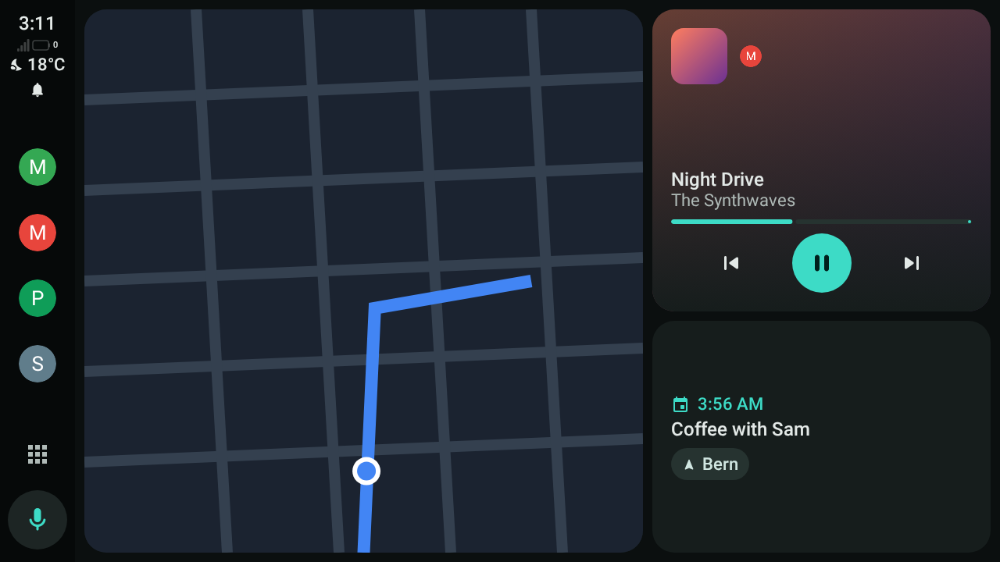 **AARE** | 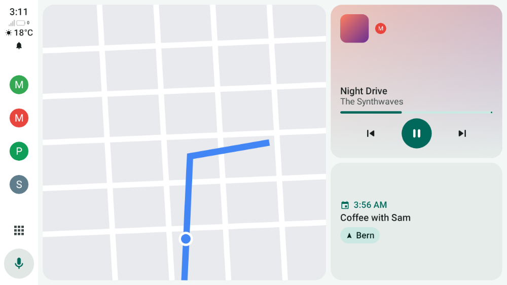 **AARE** by day |
| 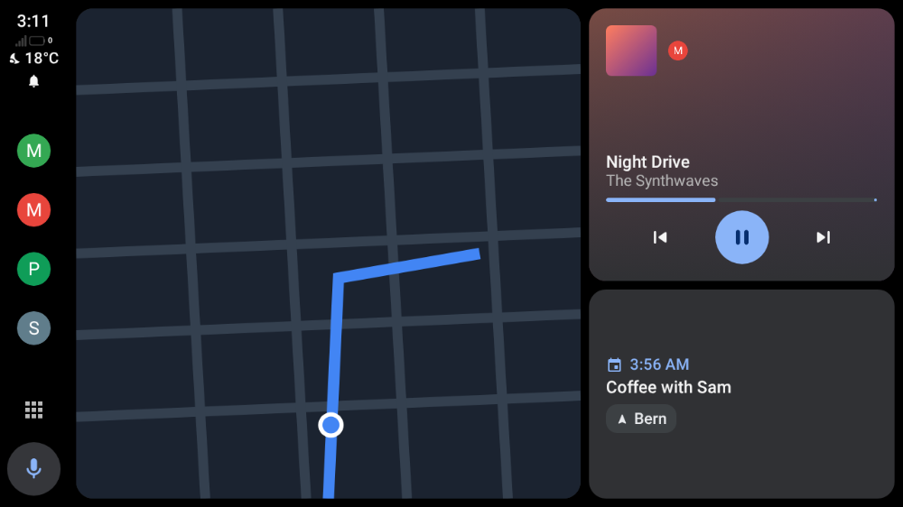 **Android Auto** | 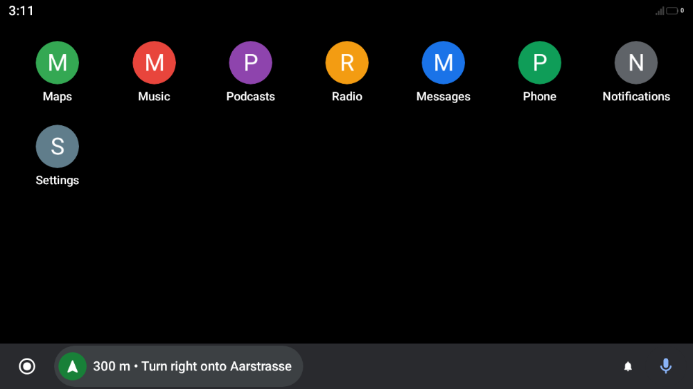 **Android Auto (2019)** |
| 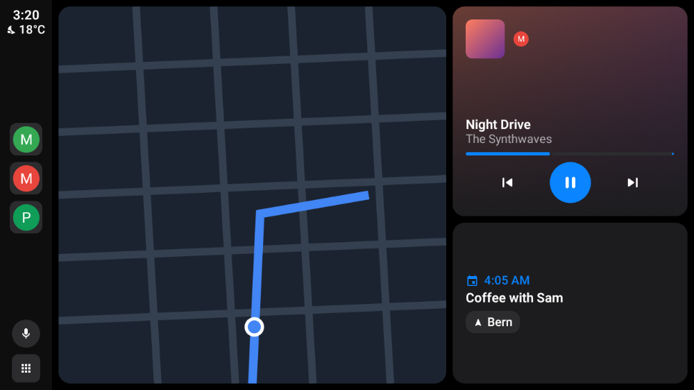 **CarPlay** | 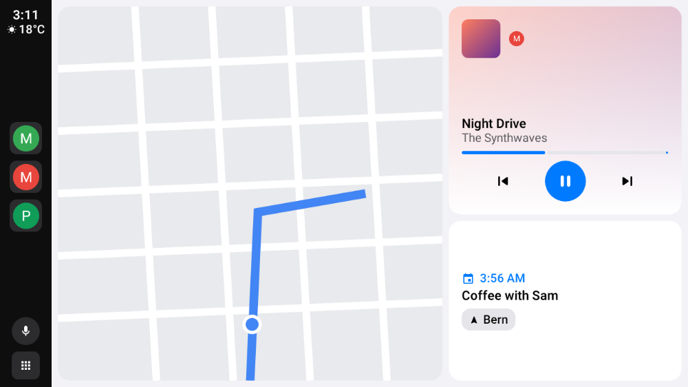 **CarPlay** by day |
| 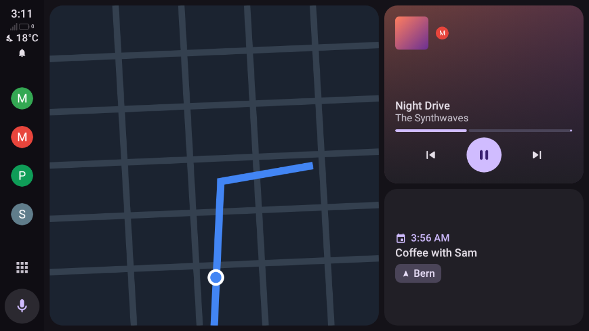 **Material You** (here Material's default colours) | 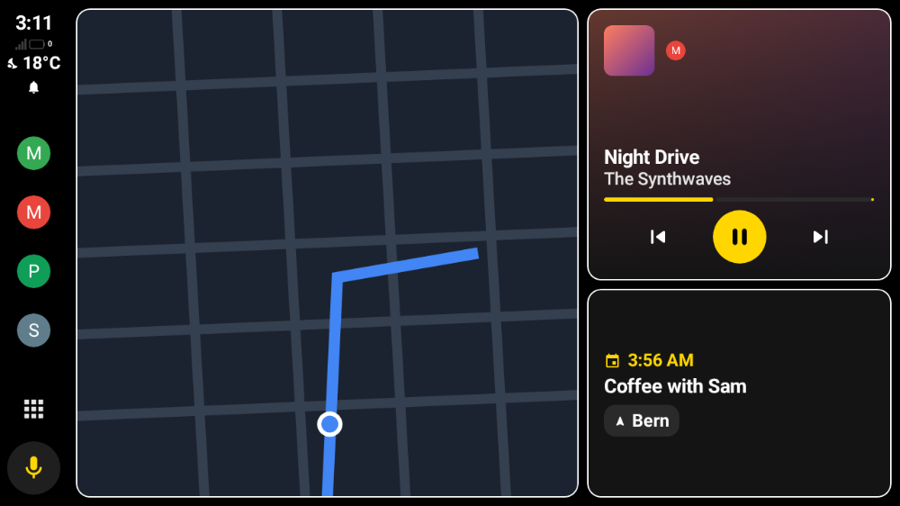 **High contrast** |
| 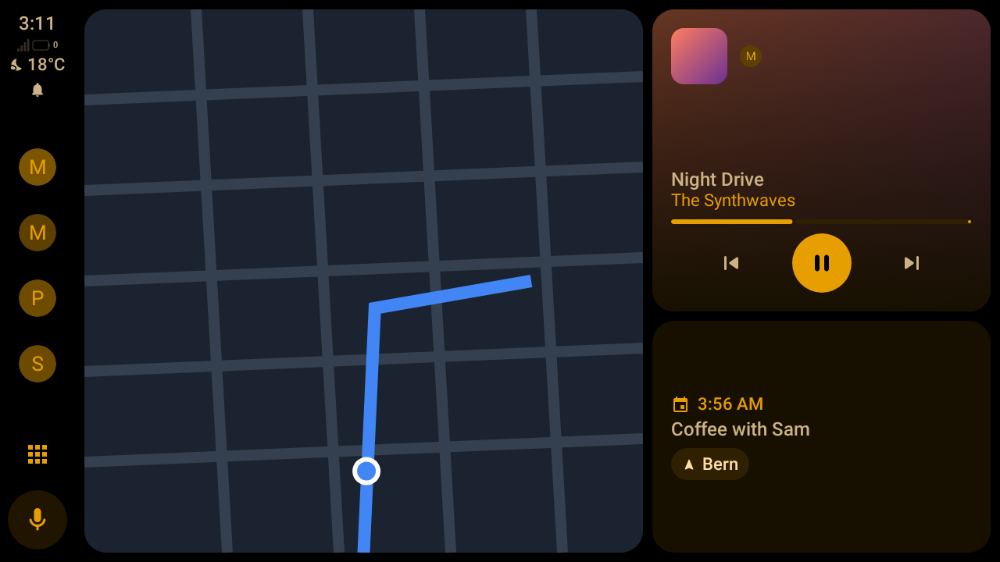 **Night** | 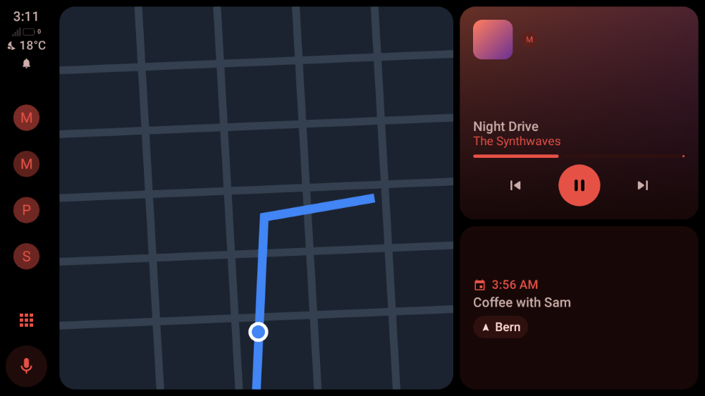 **Night**, red accent |
| 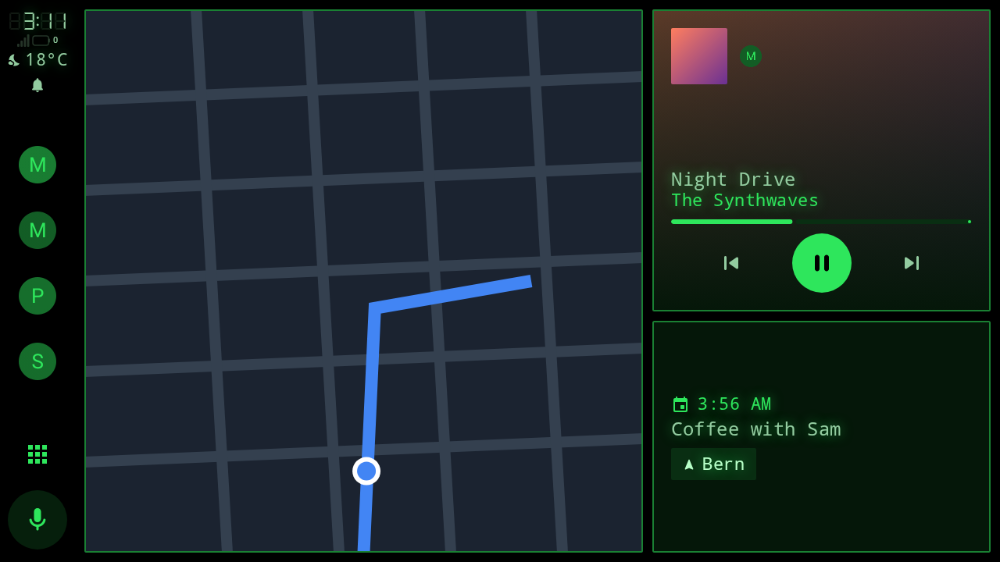 **Retro** | 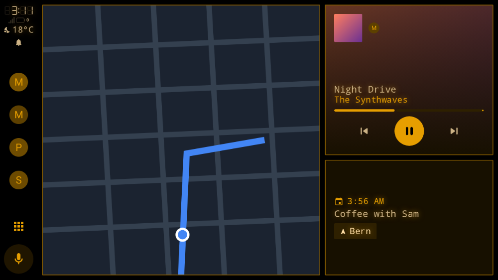 **Retro**, amber accent |
| 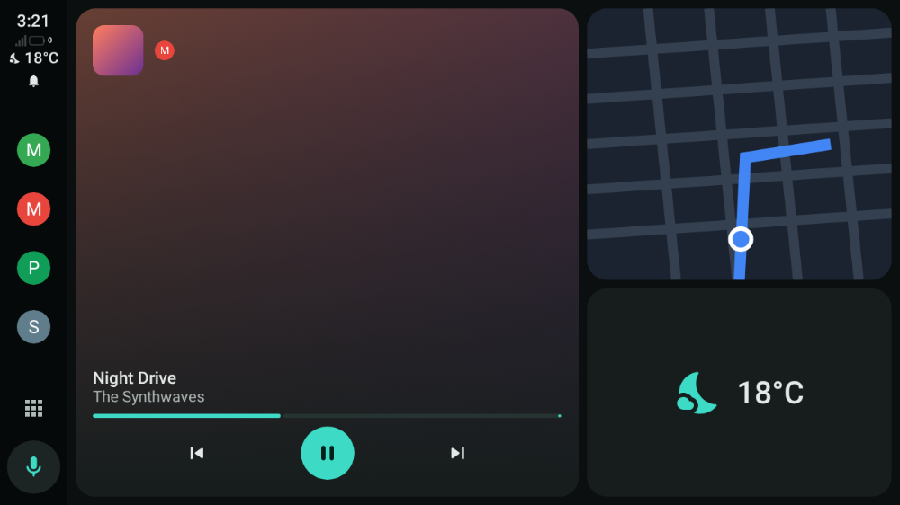 **Dashboard** set to music, map, weather | |

| | |
|---|---|
|  |  |
| The voice button: the assistant as a bar over the screen | All apps |
|  | |
| The car's settings | |

AARE is not affiliated with Google or Apple.

### Voice assistant

| Choice | What the voice button does |
|---|---|
| **Same as the phone** (default) | the phone's default digital assistant (*Settings > Apps > Default apps > Digital assistant*) |
| an assistant with a car app (e.g. [Lapin](https://github.com/prototux/lapin)) | a bar over the current screen, like Android Auto's assistant: it listens through the car's microphone and answers right away |
| any other assistant | opens it on the phone; it uses the phone's microphone |

The assistant bar shows the assistant's car screen when it is a message (Lapin's is). Tap it to
open the assistant full screen; it closes by itself after the answer. Assistants can also act on
the car: navigate, play music, read and answer messages ([car tools](#car-tools-for-assistants)).
With Lapin you can say "take me to the nearest charger", "what's the next turn?", "read my
messages" or "reply to Alex that I'm 10 minutes late".

## Apps

### Which apps appear

| Kind of app | Found by | In AARE |
|---|---|---|
| Car App Library apps (CoMaps, Organic Maps, OsmAnd, EV charging…) | `androidx.car.app.CarAppService` | yes |
| Media apps | `MediaBrowserService` / media3 `MediaLibraryService` | yes |
| Messaging apps | `<uses name="notification"/>` in `automotive_app_desc`, and the default SMS app | yes, from their notifications |
| Google Maps, Waze and other apps on Google's private car interface | Android Auto only | with root ([below](#running-the-apps-google-locks-to-android-auto-rooted-phones)) |

Some apps, Google Maps and Waze among them, draw their car screen through an undocumented
interface that only Google's Android Auto app can host, and they check that the host is Google's.
AARE's settings list every app that declares Android Auto support but that AARE can't show, with
the reason. Without root, two things make up for it:

- **Their directions in the car.** While Google Maps, Waze or another app guides you on the
  phone, AARE reads its navigation notification and shows the next turn, the distance and the
  arrival time on the dashboard and on the car's instrument cluster. Their voice prompts reach
  the car through the phone's Bluetooth link.
- **The phone screen** (below), which shows navigation apps even while driving.

### Phone screen, browser, phone apps and car data

Extra apps for the car's app list, each off by default:

- **Phone screen:** the phone's own screen in the car, to use any app from there.
  - It uses the screen-capture permission (*Car audio* page, choose *Entire screen*).
  - Touching it needs AARE's accessibility service (*Touch on the phone screen* in *Setup*; for a
    sideloaded APK, Android may first ask you to *Allow restricted settings* in AARE's app info).
  - Turn on *Phone screen in the car* in *Setup*. It is not offered on a session from the
    developer head unit server unless you also turn on *Phone screen on the server* under *Head
    unit server* (risky: whoever connects sees the phone's screen and can tap on it).
  - The phone must stay unlocked: the mirror and the touch replay pause while it is locked, and
    the picture is the phone's, in portrait unless you turn the phone.
  - While driving it only shows a navigation app (Google Maps, Waze, Amap, Yandex and others it
    knows, or the one that is guiding).
- **Browser:** a web browser with the car keyboard, parked only.
- **Phone apps:** ordinary phone apps of your choice, on the car screen, parked only. Needs root
  or Shizuku (*Apps > Apps on the car screen (advanced)*).
- **Car data:** the live data the car shares (speed, RPM, fuel and range, temperatures, doors,
  lights, tyres…), in a diagnostics app.

### Running the apps Google locks to Android Auto (rooted phones)

Three separate checks keep a non-Google host like AARE out of the apps that otherwise support
Android Auto. Each is tied to Google's own signing certificate or to a signature-level permission
that only Google-signed software can hold, so on a normal phone there is no way around them. On a
**rooted phone**, the optional [AARE host-shims Xposed module](xposed/README.md) lifts each one,
and the apps then run in AARE.

1. **The Car App Library host check.** Navigation and other template apps built on
   `androidx.car.app` check the host's signing certificate against an allowlist of Google's car
   apps; AARE's isn't on it, so they refuse the connection (*"Unrecognized host"*). The module's
   `HostValidator` hook makes them accept AARE.
   *Impacted:* **Waze, 2GIS, Yandex Maps, EasyPark**, and newer builds of other template apps.
2. **The media caller check.** Media apps hand their Android Auto browse tree only to callers
   whose package, and for many whose signing certificate, is on an allowlist of Google's car apps.
   The module makes AARE's requests pass that check, admitting AARE by **its own real
   certificate**, so no Android Auto install is needed.
   *Impacted:* **Spotify, YouTube Music, SoundCloud, Tidal, VRadio**, and other media apps that
   gate on Android Auto.
3. **Google Maps' private projection.** Maps doesn't use the public library at all: it renders
   through an undocumented `ICarProjection` interface and checks a signature-level permission
   (`CAPTURE_VIDEO_OUTPUT`) on whatever hosts it. AARE implements that interface, and the module
   grants that one permission to AARE's own UID.
   *Impacted:* **Google Maps**.

> **A rooted phone is required, by design: Google's, not AARE's.** None of these checks exist for
> safety or for the apps to function; they exist only to lock car projection to software Google
> has signed, and to shut out every independent host. On an unrooted phone these apps stay in the
> *can't show* list, and only their directions and the phone screen are available.

## Car audio

AARE uses the best way to send the phone's sound to the car that the phone allows:

| Method | Needs | Navigation voice | Phone speaker |
|---|---|---|---|
| **System audio routing**, as Android Auto does it | a rooted phone, AARE installed as a privileged app (below), or the permission granted over `adb root` | yes, on the car's navigation channel | off |
| **Shizuku** | [Shizuku](https://shizuku.rikka.app/) running, Android 12+ | yes, on the car's navigation channel | off |
| **Screen-capture permission** | one consent (choose *Entire screen*) | no | still plays |

- **Privileged install (root):** `tools/magisk/build-module.sh` makes `build/aare-magisk.zip`
  (each release has it too). Install it from Magisk (*Modules > Install from storage*) and reboot.
  AARE is then in `/system/priv-app` with `MODIFY_AUDIO_ROUTING`. Later updates install normally
  if they are signed with the same key.
- **`adb root` (no Magisk):** on builds where `adb root` works (debug builds, or ROMs with a
  *Rooted debugging* option such as LineageOS), the permission can be granted directly, and AARE
  then uses system audio routing
  ([reported in a discussion](https://github.com/prototux/AARE/discussions/146); whether it
  survives an AARE update or a reboot isn't confirmed yet). Retail phones don't allow `adb root`.

  ```sh
  adb root
  adb shell pm grant net.prototux.aare android.permission.MODIFY_AUDIO_ROUTING
  ```
- **Shizuku (no root):** install Shizuku and start it (wireless debugging, once after each
  reboot). Then on AARE's *Car audio* page tap *Shizuku* to allow AARE. The shell that Shizuku
  runs as holds `MODIFY_AUDIO_ROUTING`, so AARE registers the same audio policy as the
  privileged install from there: music and navigation voice go to their own car channels. If
  the phone refuses it, AARE falls back to recording the phone's whole output, with navigation
  voice mixed into the music.
  On phones that switch wireless debugging off when they lock (Samsung), start Shizuku from a
  computer over USB instead, with the command Shizuku shows under *Start via connecting to a
  computer*: started that way it doesn't need wireless debugging, and runs until the phone
  reboots (as long as USB debugging stays on)
  ([discussion](https://github.com/prototux/AARE/discussions/49)).
- **Screen capture:** works everywhere, but Android only gives normal apps media, game and
  "unknown" sounds, so navigation voice stays on the phone, and apps may opt out. Android asks
  for the permission again once AARE has been closed. Reported but not confirmed yet: after a
  one-time `adb shell appops set net.prototux.aare PROJECT_MEDIA allow` (no root needed),
  Android approves AARE's request without the dialog, so tapping *Screen-capture permission* is
  enough ([discussion](https://github.com/prototux/AARE/discussions/88)). It may not hold on every
  phone, or after a reboot.

Some cars keep playing the phone's **Bluetooth** audio while in Android Auto mode (the Toyota
Land Cruiser in [Tested on real head units](#tested-on-real-head-units) does). With those, none
of the above is needed: pair the phone with the car and leave *Car audio* unset.

**Samsung Galaxy / One UI:** *Settings → Sounds and vibration → Separate app sound* can route
chosen navigation or media apps directly to a paired **vehicle Bluetooth audio device**. A Galaxy
S23 owner reports hearing both music and spoken navigation guidance this way. This is **phone
Bluetooth output**, not proof that AARE captures navigation voice or sends it over an AAP audio
channel; it also does not verify simultaneous official Android Auto plus AARE projection.
See [Samsung Separate app sound and Bluetooth](docs/samsung-separate-app-sound.md) for the
setup, caveats and the scoped field report.

## Compatibility

### Tested on real head units

Reports from users, newest versions last. "AA key extraction" means the car needed Android Auto's
certificate ([one tap](#aa-key-extraction)).

| Head unit | Phone | Link | AARE | Result |
|---|---|---|---|---|
| Factory 10.2" multimedia screen of a 2022 Hyundai Kona Electric (LG Electronics Standard GEN5 Wide) | Google Pixel 10 Pro | USB | 1.2.0 + touch fix | **Works after the touch fix and [AA key extraction](#aa-key-extraction)** (reported by a user). The unit advertises a 0x0 touchscreen; the fix uses the visible video dimensions when the panel size is unspecified. |
| ZLink 3 aftermarket unit, model K2001N (Allwinner T3, Android 7, sold as Android 12), in a VW Golf 6 | Pixel 10 Pro XL, Android 17 | Wireless | 1.1.0 | **Works:** full sessions with video, with AARE's own certificate. On Android 17 it needs the local network permission ([#22](https://github.com/prototux/AARE/pull/22)). Known issue: the unit asks for 1280x720 at 160 dpi with 256x120 margins, and the screen edges are cut off. |
| Denso Ten E-DA2, the factory unit of a 2026 Toyota Land Cruiser 79 series (wired Android Auto only) | Samsung Galaxy S23 (SM-S911B), Android 16, not rooted | USB | not stated | **Works**, all features tried ([#37](https://github.com/prototux/AARE/issues/37)), with AARE's own self-signed certificate. The unit also plays the phone's Bluetooth audio during Android Auto, so the car audio setup isn't needed. |
| Factory unit of a 2023 Skoda Octavia V, MIB3 (VW Group) | Pixel 10, GrapheneOS, no Google services | USB and wireless | not stated | **Works after [AA key extraction](#aa-key-extraction)** (reported by a user, not tested by the maintainers): with AARE's own self-signed certificate the unit rejected the connection (`AUTH_COMPLETE` status -3, [#48](https://github.com/prototux/AARE/issues/48)); with the extracted certificate it connects. Known issue: the UI ignores the unit's video margins, so the layout is off ([#55](https://github.com/prototux/AARE/issues/55)). |
| Factory Denso unit of a 2024 Toyota RAV4 | — | — | not stated | **Rejected:** the self-signed certificate ([#46](https://github.com/prototux/AARE/issues/46)). |
| Factory unit of a 2024 Ford Transit | — | — | not stated | **Rejected:** status -3 ([#44](https://github.com/prototux/AARE/issues/44)). |
| Factory unit of a 2021 Ford Transit Custom | GrapheneOS, no Google services | USB | not stated | **Works after [AA key extraction](#aa-key-extraction)** ([discussion](https://github.com/prototux/AARE/discussions/60)), with Vela Maps; it took a few replugs the first time. Known issue: Vela Maps sometimes needs opening on the phone first. |
| Continental NAC Wave 4.4 (HW2019), the factory unit of a 2019 Citroën C5 Aircross | Fairphone (Gen 6) | USB | 1.2.0 | **Works after [AA key extraction](#aa-key-extraction)**, as well as Android Auto ([#81](https://github.com/prototux/AARE/issues/81)). |
| Volkswagen VW3166 LGE ICAS3 (smaller screen), the factory unit of a 2021 VW ID.4 | Fairphone 4, /e/OS, Shizuku, no Google services | USB | 1.2.0 | **Works after [AA key extraction](#aa-key-extraction)** ([#68](https://github.com/prototux/AARE/issues/68)); the 1.2.0 margin fix ([#61](https://github.com/prototux/AARE/pull/61)) corrected the earlier zoomed-in layout. |
| Panasonic T1 (8614002A81), the factory unit of a 2023 Toyota Corolla Touring Sports | Samsung Galaxy A7 (2018), Android 10 | USB | 1.2.0 | **Works after [AA key extraction](#aa-key-extraction)** ([#79](https://github.com/prototux/AARE/issues/79)); Vela maps and Symfonium audio work. Known issue: navigation lost location once the phone locked ([#87](https://github.com/prototux/AARE/issues/87), fixed in [#94](https://github.com/prototux/AARE/pull/94)). |
| Easylink Bosch RM RNAIVI, integrated in a 2023 Renault Zoe | Fairphone FP5, /e/OS, microG, rooted | Wireless | 1.2.0 | **Partly works after [AA key extraction](#aa-key-extraction)** ([#76](https://github.com/prototux/AARE/issues/76)): the car-audio player works, but the head unit doesn't display the AARE screen, so nothing else does. |
| Factory unit of a 2022 Chevrolet Bolt EUV | Pixel 8 Pro | USB and wireless | 1.2.0 | **Works with issues** ([#80](https://github.com/prototux/AARE/issues/80)): connects with the AA certificate, but touches land up and to the left of where they're tapped, and apps that require Google's build (Maps, Spotify, YouTube) refuse to run. |
| Honda HFT (8A500-3A0-GD2), the factory unit of a 2025 Honda CR-V | Huawei P30, EMUI 12 (Android 10) | USB and wireless | 1.2.0 | **Works with issues** ([#70](https://github.com/prototux/AARE/issues/70)): over USB the car doesn't recognise the phone (no AA icon); over wireless it connects but the projected screen is black. |
| Mitsubishi Electric unit of a 2020 Mercedes C-Class | Pixel 10, Android 17, GrapheneOS, no Google services, no Shizuku | USB | 1.2.0 | **Works with issues** ([#69](https://github.com/prototux/AARE/issues/69)): connects and the car shows the Android Auto icon, but the projected screen is black. |
| Audi 326 (G35S) ALPINE MIB2+, the factory unit of a 2019 Audi Q3 | Samsung Galaxy S24 Ultra, Android 17 | USB | 1.2.0 | **Rejected** ([#86](https://github.com/prototux/AARE/issues/86)): shows the AARE screen for ~3 seconds, then returns to the car UI — "no version request from head unit". |
| Ford SYNC 4.0, the factory unit of a 2026 Ford Mustang Mach-E (portrait screen) | Pixel 9 Pro, GrapheneOS, no Google services, not rooted, Shizuku | USB and wireless | 1.2.0 + [#103](https://github.com/prototux/AARE/pull/103)–[#106](https://github.com/prototux/AARE/pull/106) | **Works after [AA key extraction](#aa-key-extraction) with those fixes** ([#74](https://github.com/prototux/AARE/issues/74)): video, touch, audio and apps. On 1.2.0 it doesn't connect (USB "read failed", wireless "Bluetooth bootstrap link failed"). The unit leaves out every protocol field that is 0 (#103), offers two media and two guidance channels (#104), and declares a 1200x1244 touch panel but reports touches in pixels of the 1042x1080 area it shows (#105). Wireless only starts once the car has been on Bluetooth for a few seconds (#106). |
| Factory unit of a 2021 Fiat 500e | Samsung Galaxy A50, Android 11, not rooted | USB | 1.2.0 | **Works with issues after [AA key extraction](#aa-key-extraction)** ([#108](https://github.com/prototux/AARE/issues/108)): car audio through the screen-capture permission didn't play, and with the bar on the right the Home button was missing (both on 1.2.0). |
| MSIL (Suzuki) factory unit of a 2019 Maruti Suzuki Baleno | Motorola Edge 60 Pro | USB | 1.3.0 | **Rejected** with AARE's own certificates ([#127](https://github.com/prototux/AARE/issues/127)): status -3, then "no version request from head unit". Not tried with [AA key extraction](#aa-key-extraction) yet. |
| Factory unit of a 2019 Suzuki Swift Sport | Poco F5, Android 17, LineageOS, not rooted, no Google services | USB | 1.3.0 | **Rejected** with AARE's own certificates ([#140](https://github.com/prototux/AARE/issues/140)), as the Baleno above. Not tried with [AA key extraction](#aa-key-extraction) yet. |
| Bosch RCC (8"), the factory unit of a 2023 Opel Combo-e | Xiaomi 14 Ultra (Chinese model), no Google services, Shizuku | USB | 1.3.0 | **Works after [AA key extraction](#aa-key-extraction)** ([#128](https://github.com/prototux/AARE/issues/128)), car audio through Shizuku included. |
| Continental NAC Wave 4.3 (Carline 6, 7"), the factory unit of a 2023 Opel Corsa F | Huawei P20 Pro, Android 10, EMUI 12 | USB | 1.3.0 | **Works with issues** ([#134](https://github.com/prototux/AARE/issues/134)), with AARE's own certificate: audio plays, but the projected screen stays black ([#96](https://github.com/prototux/AARE/issues/96)), and the session drops with "read failed" after about 2.5 minutes ([#182](https://github.com/prototux/AARE/issues/182)). |
| Continental NAC Wave 4.4 (Carline 15), the factory unit of a 2022 Opel Vivaro-e | Huawei P40 Pro, Android 10 | USB and wireless (smartBox dongle) | 1.4.0 | **Works with issues after [AA key extraction](#aa-key-extraction)** ([#160](https://github.com/prototux/AARE/issues/160), [#167](https://github.com/prototux/AARE/issues/167)): the projected screen stays black ([#96](https://github.com/prototux/AARE/issues/96)); wireless through the dongle doesn't connect ([#42](https://github.com/prototux/AARE/issues/42)). |
| Opel IntelliLink 900, the factory unit of a 2017 Opel Insignia | Samsung Galaxy Note 8, Android 9 | USB | 1.4.0 | **Works with issues after [AA key extraction](#aa-key-extraction)** ([#173](https://github.com/prototux/AARE/issues/173)): taps land about 2 cm above and 1 cm to the right of the touch, differently on each start ([#97](https://github.com/prototux/AARE/issues/97)); some "read failed" drops ([#182](https://github.com/prototux/AARE/issues/182)). |
| Opel IntelliLink, the factory unit of a 2018 Opel Insignia B | Huawei P40 Pro, Android 10 | USB | 1.4.0 (modified build) | **Works with issues** ([#175](https://github.com/prototux/AARE/issues/175)): taps land slightly off the icons ([#97](https://github.com/prototux/AARE/issues/97)). |
| Inefala 4 aftermarket unit (Android 15, Google's receiver library) in a 2016 Hyundai i20 | Nothing Phone (2), LineageOS (Android 16), rooted (KernelSU-Next), microG | USB and wireless | 1.3.0 | **Works after [AA key extraction](#aa-key-extraction) with [#138](https://github.com/prototux/AARE/pull/138), [#141](https://github.com/prototux/AARE/pull/141), [#143](https://github.com/prototux/AARE/pull/143) and [#144](https://github.com/prototux/AARE/pull/144)** ([#139](https://github.com/prototux/AARE/issues/139)): wireless needed phone_info and pings ([#138](https://github.com/prototux/AARE/pull/138)), the others fixed audio focus and the music resuming. Some USB drops with EIO ([#182](https://github.com/prototux/AARE/issues/182)). |
| Hyundai/Mobis factory unit (LX2PE) of a 2023 Hyundai Palisade | Pixel 10 Pro XL | USB | 1.4.0 | **Works with issues after [AA key extraction](#aa-key-extraction)** ([#178](https://github.com/prototux/AARE/issues/178)): CoMaps runs, but the screen freezes with 10 to 30 s of lag and sessions end with "read failed" ([#182](https://github.com/prototux/AARE/issues/182)). Amazon Music refuses AARE (see [Car apps that only trust Google](#car-apps-that-only-trust-google)). |
| Audi 516 (G35) MIB2+, the factory MMI of a 2019 Audi e-tron | Pixel 7 Pro, Android 17, not rooted, Shizuku | USB | 1.4.0 | **Works after [AA key extraction](#aa-key-extraction)** ([#151](https://github.com/prototux/AARE/issues/151)); AARE's own certificates are rejected (status -3). It also hit the crash at the end of a USB session ([#152](https://github.com/prototux/AARE/issues/152), fixed in [#170](https://github.com/prototux/AARE/pull/170)). |
| Factory GM unit (myChevrolet) of a 2025 Chevrolet Trax | Samsung Galaxy S26 Ultra, Android 17, One UI 9, Shizuku | USB and wireless | 1.4.0 | **Works with issues after [AA key extraction](#aa-key-extraction)** ([#159](https://github.com/prototux/AARE/issues/159)): AARE's own certificates are rejected ("different dates and/or times"). The phone screen doesn't start with Shizuku car audio ([#181](https://github.com/prototux/AARE/pull/181)), and one USB cable dropped the session within seconds ([#182](https://github.com/prototux/AARE/issues/182)). |
| Ford SYNC 3 (3.4.23188), the factory unit of a 2018 Ford EcoSport | Pixel 9, GrapheneOS, no Google services, AARE Magisk module | USB and wireless (AAWireless TWO+) | 1.4.0 | **Works after [AA key extraction](#aa-key-extraction)** ([#161](https://github.com/prototux/AARE/issues/161)). Wireless needs AARE excluded from the VPN (see [VPN](#vpn)). |
| VW Play (Visteon MIB Regio, 10.1", protocol 1.5), the factory unit of a 2023 VW Polo GTS (Brazil) | Pixel 7 Pro, Android 17, not rooted, Shizuku | USB | 1.2.0, then main | **Works with [#162](https://github.com/prototux/AARE/pull/162) and [#163](https://github.com/prototux/AARE/pull/163)** ([#166](https://github.com/prototux/AARE/issues/166)), with AARE's own certificate: without them the projected screen stays black. [#171](https://github.com/prototux/AARE/pull/171) stopped it refusing navigation messages. |

**Open-source head units:** openauto/Crankshaft, Open Headunit (formerly Headunit Revived), LIVI
and aa-proxy-rs accept AARE's own certificate. A user reports AARE working well with Open
Headunit, except Waze (see [Car apps that only trust Google](#car-apps-that-only-trust-google))
and Google Assistant, which didn't work for them
([discussion](https://github.com/prototux/AARE/discussions/47)).

If you try AARE on another head unit, please
[open an issue](https://github.com/prototux/AARE/issues/new/choose) or a pull request to add it
here, whether it worked or not.

### When something's off

- **The car refuses AARE** (status -3, or "different dates and/or times"): download Android
  Auto's certificate ([AA key extraction](#aa-key-extraction)). AARE offers its certificates in
  turn: after a head unit rejects one, the next connection uses the next one.
- **The layout or the touch is off** (black bars, cut edges, taps landing beside the target):
  a per-car override can fix the density and margins without a new build, see
  [docs/vehicles.md](docs/vehicles.md).
- **Black screen with some head units:** if the car shows the Android Auto icon but no picture
  until you touch the screen, a *Phone Bluetooth address* under *Connecting* helps some units;
  otherwise see [#96](https://github.com/prototux/AARE/issues/96).
- **Reporting a problem:** AARE keeps a connection log under *Advanced*: turn on *Verbose
  protocol log*, reproduce, then copy or save it and attach it to the issue, with the car (make,
  model, year), USB or wireless.

### VPN

AARE works with a VPN app running on the phone (WireGuard, OpenVPN...), as long as the VPN's
address ranges don't overlap the head unit's network. Over wireless, the head unit's Wi-Fi has its
own addresses (often `192.168.x.x`): if the VPN claims the same range, the phone sends the car's
traffic into the VPN and the connection times out. Then change the VPN's range, or exclude the head
unit's network from the VPN (most VPN apps have a setting for local network access). USB isn't
affected.

### Coexisting with Google's Android Auto

- **USB:** both apps answer the same USB accessory, so Android asks which one to use. Choose
  AARE and *Always*, or disable Android Auto.
- **Permissions:** AARE never redeclares the permissions Android Auto defines, so both can be
  installed.

## For developers

### Status

What's implemented, and how far it has been tried.

| Part | State |
|---|---|
| Protocol: framing, TLS 1.2 (phone = server), version, service discovery, channels | done, unit and loopback tests |
| USB (AOA) | done, in daily use in many cars (see [Tested on real head units](#tested-on-real-head-units)) |
| Wireless (Bluetooth bootstrap + Wi-Fi + TCP), head units on Google's receiver library included | done, works in several cars and through wireless dongles |
| Video: H.264 hardware encoding of a private virtual display, ack flow control, focus, key-frame recovery | done |
| Adaptive video bitrate: lower when the car or a weak wireless link falls behind, back up when it catches up | new, untested on hardware |
| Portrait head units: bottom bar, stacked dashboard, dock layout | done, works on the Mustang Mach-E's portrait screen |
| Touch, keys, rotary controller, steering-wheel voice/media/home/back keys | done |
| Sensors: driving restrictions, night mode, car GPS and compass (passed to nav apps) | done |
| Every other sensor the car offers (RPM, odometer, fuel and range, temperature, HVAC, doors, lights, tyres, accelerometer, gyroscope…) for car apps (car hardware API), the assistant and the car data app | new, tested only with the desktop head unit's fake car |
| Car App Library host: handshake, templates, map surface, navigation trips, alerts, car hardware, microphone | done |
| Template rendering (list, grid, pane, message, search, sign-in, tabs, navigation, map...) | done |
| Media apps: browse, search, now playing, transport, active session tracking | done |
| Messaging apps: conversations from notifications, read aloud, mark as read, reply when parked | done, in daily use |
| Turn-by-turn to the instrument cluster and now-playing to the head unit | done |
| Instrument-cluster video (cars with a cluster display): the navigation app's cluster map, or AARE's turn card | new, tested only with the desktop head unit's `--cluster` |
| Directions from Google Maps, Waze… on the phone, on the dashboard and the cluster | new, untested with Google Maps and Waze |
| Phone screen in the car, with touch | new |
| Phone audio to the car: screen capture, Shizuku, or system audio routing like Android Auto (music and navigation voice apart) | screen capture and Shizuku in use in cars; system routing new |
| Voice assistant as a bar over the screen, with car tools | done, works in a car with Lapin |
| Car microphone to apps (any `CarAudioRecord` app) | done |
| Phone status to the car (call state, caller name and photo, signal), battery level; the car's call buttons answer and hang up | new, tested only with the desktop head unit |
| More audio buffering after the car reports underflows | new, untested on hardware |
| Developer head-unit server over adb (DHU, openauto, Open Headunit), optional LAN TCP 5277 | done |

**Not planned** (rare, or redundant with what AARE draws itself):

| Missing | Why not |
|---|---|
| Radio service (AM/FM/DAB tuning, presets) | Very few head units offer it to the phone. |
| Vendor extensions | Specific to each car maker, undocumented. |
| Generic notifications service | AARE shows notifications on its own screen; sending them to the car would show them twice. |
| Native media browser service | Same: media apps are browsed on AARE's own screen. |
| User switch, connected-devices list, service discovery update | Only matter with several phones in the car or channels changing during a connection. |
| Audio kept open with silence | AARE closes the car's audio stream after a few seconds of silence and reopens it when sound comes back, like Android Auto does for navigation prompts. |

### Testing without a car: the desktop head unit

`./headunit.sh` turns your computer into a car for a phone or emulator connected with adb. You
need `adb` (Android SDK platform-tools), `ffmpeg` and a JDK 17-21.

1. On the phone, turn on USB debugging and plug it into the computer.
2. Install a **debug** build of AARE (`./build.sh && adb install -r app/build/outputs/apk/debug/app-debug.apk`).
3. Run `./headunit.sh`.

The script forwards TCP 5277 to the phone's `@aare_hu` socket over adb (`adb forward tcp:5277
localabstract:aare_hu`), switches on AARE's head-unit server (debug builds do it when asked; on
release builds, turn on *Head unit server* in AARE's settings), builds the desktop head unit and
opens a window showing the car screen. The *Phone screen* app is not offered on this server
unless you turn on *Phone screen on the server* (next to *Head unit server* in AARE's settings),
as its peer is unauthenticated.

```sh
./headunit.sh                       # AARE, through AARE's desktop head unit
./headunit.sh google                # the official Android Auto app, through Google's Desktop Head Unit
./headunit.sh --res 1920x1080 --time-scale 10 --speed 110 --rhd
./headunit.sh --cluster             # also an 800x480 instrument cluster, in a second window
./headunit.sh --portrait            # a portrait screen (720x1280)
```

| On the computer | In the car |
|---|---|
| mouse | the touch screen |
| Esc / Backspace | back |
| H | home |
| V | the steering-wheel voice button |
| wheel / arrows | rotary controller |
| K / `,` / `.` | play-pause / previous / next |
| N / P | night mode / parked |

The window also gives you:

- **Audio:** the car's audio channels play on your speakers.
- **Microphone:** your microphone becomes the car's microphone, so you can talk to the assistant.
- **Side panel:** the phone's turn-by-turn instructions and now playing.
- **Simulated drive:** follows a real 775 km **Paris → Marseille** route (OpenStreetMap data via
  OSRM), slower in towns, with pause and ×10 / ×60 / ×300 time acceleration. It is sent as the
  car's GPS, speed and gear.
- **Emulator GPS:** on an emulator, the phone's own GPS is moved along the route too, so apps
  that use the phone's location (CoMaps) follow it.
- **Headless mode:** `--headless DIR --script "tap:640,360@10 key:4@12"` runs without a window
  and saves screenshots, for automated tests.
- **Test options**, to try AARE's error and logging paths without a car: `--name`, `--make`,
  `--model`, `--year`, `--hu-make`, `--hu-model`, `--hu-sw` and `--vehicle-id` set what the head
  unit says about itself; `--fault`, `--refuse-channel`, `--ignore-channel`, `--no-audio-ack`,
  `--video-ack-delay`, `--mic-status`, `--no-audio-focus`, `--no-video-focus` and `--ping-ms` make
  it misbehave; `--aac-sink` (listed only), `--unknown-service`, `--video-codec` (the offer only:
  the window still decodes H.264 only) and `--wifi-projection` (with a fake password for phones
  that ask for the car's Wi-Fi credentials) change what it offers; and `--script` also takes
  protocol events (`bye`, `longkey:3`, `audiofocus:loss`, `garbage:7`...).
  `headunit/build/install/aare-headunit/bin/aare-headunit --help` lists them all. While unused,
  they change nothing.

AARE's head unit works with AARE (or other open-source phone implementations), not with Google's
Android Auto app: Android Auto only accepts head units whose certificate is issued by Google, and
this one's is self-signed. The head unit says so when a phone refuses it. AARE refuses a
certificate it hasn't seen until you tap *Trust* on its *New head unit* notification (or on
AARE's home screen) and connect again; the head unit keeps its own certificate in
`~/.config/aare/headunit` (`%APPDATA%\aare\headunit` on Windows), so you tap *Trust* once, unless
you give it another with `--hu-cert`/`--hu-key`.

**Google mode** runs Google's Desktop Head Unit, downloading it if needed, with the same drive on
an emulator's GPS. The official app only accepts head units with a Google-issued head-unit
certificate, which AARE doesn't include, so Google's own tool is the way to compare. Turn on
*Start head unit server* in Android Auto's developer settings first. AARE's head unit can also
present a head-unit certificate you supply (`--hu-cert`, `--hu-key`).

**Other head units on the head-unit server.** The phone only accepts the head-unit server's adb
connection from adb itself (uid shell or root), so other apps on the phone can't use it
(processes running as shell, such as `adb shell` or Shizuku, are accepted). For Google's DHU, or
any tool on the computer running adb, run `adb forward tcp:5277 localabstract:aare_hu` and point
it at `localhost:5277`; head units on another device (Open Headunit, or openauto on a Pi) need
*Accept from the network*. The desktop head unit takes `--adb-target tcp:5277` to drive the
official Android Auto app's head unit server instead. *Accept from the network* opens TCP 5277 on
every network interface with no authentication: anyone on the same Wi-Fi can connect (apps on the
phone itself are refused on every interface), so by default AARE switches it off again after one
session. openauto and Open Headunit reconnect on their own and would find it off: for them, turn
off *Turn off network mode after a session* so network mode stays on until you switch it off.

Other tools:

- `./gradlew :aap:runPhoneSim --args="test.h264"`: a desktop "phone" that serves an H.264 file
  on TCP 5277, to exercise head-unit software.
- `./build.sh :aap:test`: protocol tests, including full sessions against a simulated head unit.
- `tools/mockups.sh`: draws the car screen mockups above with Paparazzi, on the JVM.

### Car tools for assistants

The assistant the voice button opens can act on the car through
`content://net.prototux.aare.car` (`ContentResolver.call`): `call("tools")` returns tool specs in
the function-calling JSON schema, and `call("run", name, {"args": json})` runs one. AARE only
answers that assistant, and only while a car (or the preview) is connected.

| Tool | Does |
|---|---|
| `car_status` | what's on screen, driving or parked, navigation, now playing, the phone's battery and signal |
| `car_navigate` | navigates to a place in the car's navigation app |
| `car_media` | play, pause, next, previous |
| `car_open` | shows an app, home, the app list or the phone screen |
| `car_messages` | the latest messages, to read them out |
| `car_reply` | replies to a conversation (the assistant reads the reply back for confirmation first) |
| `car_mark_read` | marks a conversation as read |
| `car_display` | dark, light or the car's day/night colors |

Lapin adds them to its own device tools when it runs on AARE.

### Car apps that only trust Google

A Car App Library app decides which hosts it accepts (`HostValidator`).

- **Debug builds** of most apps accept any host.
- **Release builds:** apps built with car-app library 1.8.0-beta01 or older also accept a host
  holding `android.car.permission.TEMPLATE_RENDERER`. AARE holds it, so CoMaps (1.7.0), Organic
  Maps (1.8.0-alpha02) and Lapin (1.7.0) work today.
- **Newer library versions** dropped that path on phones. Those apps need AARE's signing
  certificate digest in their allow-list (or, on a rooted phone, the
  [Xposed module](#running-the-apps-google-locks-to-android-auto-rooted-phones)):

  ```kotlin
  HostValidator.Builder(context)
      .addAllowedHosts(androidx.car.app.R.array.hosts_allowlist_sample)
      .addAllowedHost("net.prototux.aare", "<sha256 of AARE's signing certificate>")
      .build()
  ```

  For the releases, the digest is the release key's SHA-256 above (without the colons, in
  lowercase). For your own builds, get it with `apksigner verify --print-certs app-debug.apk`.
  For apps you build yourself, add it to their allow-list. For others, ask upstream.

### Building

CI builds and tests every push. Pushing a `v1.2.3` tag publishes a release (`.github/workflows/`).

You need a JDK 17-21 and the Android SDK (Android Studio installs both).

```sh
echo "sdk.dir=$HOME/Android/Sdk" > local.properties   # or set ANDROID_HOME
./build.sh                    # debug APK: app/build/outputs/apk/debug/app-debug.apk
./build.sh :aap:test          # protocol tests: framing, TLS, a full session against a simulated head unit
./build.sh :app:testDebugUnitTest
```

`build.sh` finds a suitable JDK and runs Gradle. On a machine without swap, set
`AARE_BUILD_MEMORY=5G` to run the build in a memory-capped systemd scope. Opening the project
in Android Studio works too.

### Layout

| Folder | What |
|---|---|
| `aap/` | the protocol, pure Kotlin/JVM: framing, TLS, session, channels, wireless bootstrap, simulators and tests |
| `aap/src/main/proto/` | AAP protobuf definitions, from [aasdk](https://github.com/opencardev/aasdk) |
| `app/.../car/` | a projection session: video, input, sensors, audio, microphone, cluster |
| `app/.../host/` | the Car App Library host, the car runtime (app list, routing, UI root), the assistant bar and car tools |
| `app/.../host/templates/` | Compose rendering of car app templates |
| `app/.../media/` | media apps: discovery, media3 browser, now playing, UI |
| `app/.../mirror/` | the *Phone screen* app: mirroring and touch |
| `app/.../audio/` | car audio: capture methods (audio policy, Shizuku, screen capture), microphone |
| `app/.../notify/` | notifications: messaging apps, and directions from navigation apps on the phone |
| `app/.../transport/` | USB accessory, TCP server, wireless (Bluetooth + Wi-Fi) |
| `app/.../ui/` | phone UI, car shell (rail, dashboard, launcher), theme |
| `headunit/` | the desktop head unit (`./headunit.sh`) |
| `tools/magisk/` | Magisk module that installs AARE as a privileged app |
| `xposed/` | the optional host-shims module for rooted phones |
| `docs/` | certificates, per-vehicle overrides, decisions; `docs/research/`: protocol notes |

### Contributing

Bug reports and pull requests are welcome. Reports from real cars are the most useful: say which
head unit (make, model, year, or the open-source software it runs), USB or wireless, and attach
AARE's connection log (*Advanced > Verbose protocol log*), or `adb logcat` output around the
connection (`adb logcat | grep -i aare`).

Before sending a pull request, run `./build.sh :aap:test` and build the app.

## Thanks

To [@dustfeather](https://github.com/dustfeather), for a security review of AARE and the fixes
that came with it:

- the protocol: the handshake order enforced, fragment reassembly capped;
- trust: new or changed head unit certificates need your approval, the developer head unit
  server is reachable through adb only unless you open it to the network;
- car apps: the microphone, location and calls need the app's own permission or your action,
  artwork and notification images only load from the app that supplied them;
- wireless: open Wi-Fi refused, and the local network permission Android 17 needs;
- the phone screen off by default and paused while the phone is locked;
- GitHub Actions pinned to commits, and Dependabot;

and for the first test of AARE in a real car.

Code fixes and docs from [@s-ratashnyuk](https://github.com/s-ratashnyuk) (zero-panel touch
mapping, the map pinch gesture, standalone apps during screen sleep),
[@JVKeller](https://github.com/JVKeller) (Mazda command-knob focus, the black screen after
connecting), [@jameswynn](https://github.com/jameswynn) (a copyable connection log, and the Ford
Mustang Mach-E fixes: zero-omitting head units, two media and guidance channels, touch in visible
pixels, the wireless Bluetooth wait), [@pafolol](https://github.com/pafolol) (the Samsung USB
permission fix), [@jooray](https://github.com/jooray) and [@KrishnaX12](https://github.com/KrishnaX12)
(README and key-extraction docs), [@freezed23](https://github.com/freezed23) (the Samsung
separate-app-sound write-up), [@MattMaaaan](https://github.com/MattMaaaan) (diagnosing and patching
navigation location while the phone is locked, the reverse-camera video restart, car audio through
Shizuku, the Ford SYNC 2.5 audio crackle and the home screen's map card),
[@l0rdg3x](https://github.com/l0rdg3x) (head units on Google's receiver library, audio focus,
pausing and resuming the music with the car, and the home screen's music card),
[@akanshu-sapra](https://github.com/akanshu-sapra) (the black screen on Android 8) and
[@filipeniquini](https://github.com/filipeniquini) (navigation messages for protocol 1.5 head units).

Head-unit reports from [@Shane11r](https://github.com/Shane11r),
[@dani203](https://github.com/dani203), [@pgwipeout](https://github.com/pgwipeout),
[@tylertneal](https://github.com/tylertneal), [@rutgerputter](https://github.com/rutgerputter),
[@ranjowd](https://github.com/ranjowd), [@remyzerems](https://github.com/remyzerems),
[@breversa](https://github.com/breversa), [@alkralor](https://github.com/alkralor),
[@xaoc7](https://github.com/xaoc7), [@matthias-hoste](https://github.com/matthias-hoste),
[@paulhiggs](https://github.com/paulhiggs), [@F4FXL](https://github.com/F4FXL),
[@sheshuv](https://github.com/sheshuv), [@NorwegianGoat](https://github.com/NorwegianGoat),
[@rogerngks](https://github.com/rogerngks), [@notsobadd](https://github.com/notsobadd),
[@Rikardogonc](https://github.com/Rikardogonc), [@opalek84](https://github.com/opalek84),
[@l0rdg3x](https://github.com/l0rdg3x),
[@spasticmonkey55-glitch](https://github.com/spasticmonkey55-glitch),
[@gitzone83](https://github.com/gitzone83), [@djshag01](https://github.com/djshag01),
[@mirchisait](https://github.com/mirchisait), [@filipeniquini](https://github.com/filipeniquini),
[@MattMaaaan](https://github.com/MattMaaaan) and [@cfercl](https://github.com/cfercl)
— see [Tested on real head units](#tested-on-real-head-units) for the cars. Reports and ideas that
led to changes from [@sadorowo](https://github.com/sadorowo) (a car that stops acknowledging audio,
#82), [@henkv1](https://github.com/henkv1) (connections from the phone itself, #131),
[@kveld9](https://github.com/kveld9) (the translations, #51), [@Ronsone](https://github.com/Ronsone)
(the Audi A3's authentication answer, #43), [@pollio2008](https://github.com/pollio2008) (more
navigation apps on the phone screen, discussion #150) and [@Delgrey](https://github.com/Delgrey)
(Open Headunit, discussion #47). And tips from
[@teccheck](https://github.com/teccheck) (the `adb root` audio grant) and
[@JVKeller](https://github.com/JVKeller) (the screen-capture appops grant).

## License

GPL-3.0-or-later (see [LICENSE](LICENSE)). The protobuf definitions come from aasdk
(GPL-3.0-or-later, see [aap/src/main/proto/NOTICE.md](aap/src/main/proto/NOTICE.md)).
The Retro theme's clock uses the DSEG7 Classic font by keshikan (SIL Open Font License 1.1, see
[app/src/main/assets/licenses/DSEG-LICENSE.txt](app/src/main/assets/licenses/DSEG-LICENSE.txt)).

Not affiliated with or endorsed by Google or Apple. Android Auto is a trademark of Google LLC;
CarPlay is a trademark of Apple Inc.
